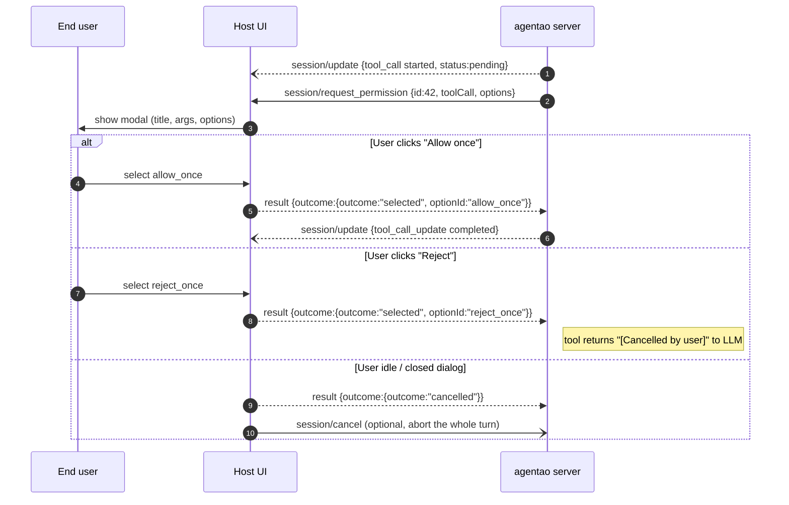

# 3.2 Agentao as an ACP Server

Drive Agentao as a black-box ACP server — the integration path for hosts in **any language** (Node, Go, Rust, Kotlin, Swift, C#…).

## Launch command

```bash
agentao --acp --stdio
```

- `--acp` enables ACP mode
- `--stdio` names the transport. stdio is the only transport in v1, so `--acp` implies it. `agentao --acp` alone also works, and that is how ACP Registry clients launch it. `--stdio` without `--acp` exits with code `2`
- `python -m agentao --acp --stdio` does the same without the console script on `PATH`
- The process runs until stdin closes or `SIGTERM` is received

**Credentials**: the ACP wire never carries them. See [Provider configuration and login](#provider-configuration-and-login) for where a session gets its LLM settings.

**Output**: stdout carries only JSON-RPC messages. Logs and any stray `print()` go to stderr.

**Logs**: Agentao writes to `<session-cwd>/agentao.log` (the `cwd` from `session/new`). Hosts can tail / inspect it for debugging.

### Smoke test by hand

Pipe two requests in and read two responses back:

```bash
OPENAI_API_KEY=sk-... OPENAI_BASE_URL=https://api.openai.com/v1 OPENAI_MODEL=gpt-5.4 \
agentao --acp --stdio <<'EOF'
{"jsonrpc":"2.0","id":1,"method":"initialize","params":{"protocolVersion":1,"clientCapabilities":{}}}
{"jsonrpc":"2.0","id":2,"method":"session/new","params":{"cwd":"/tmp","mcpServers":[]}}
EOF
```

Expected on stdout (abridged):

```json
{"jsonrpc":"2.0","id":1,"result":{"protocolVersion":1,"agentCapabilities":{"loadSession":true,…},"authMethods":[],"agentInfo":{"name":"agentao","title":"Agentao","version":"<installed version>"},"_meta":{…}}}
{"jsonrpc":"2.0","id":2,"result":{"sessionId":"sess_<32 hex>","configOptions":[…]}}
```

If `id: 2` comes back as error `-32000`, no provider is configured. See [Troubleshooting](#troubleshooting). For an interactive try that also sends a prompt, see [3.1 · Quick try in 60 seconds](./1-acp-tour#quick-try-in-60-seconds).

## Provider configuration and login

A client that installs Agentao from the [ACP Registry](https://agentclientprotocol.com/registry) launches it through `uvx` (`uvx agentao@<version> --acp`). There is then no `.env` to edit and no `agentao` on `PATH`. Since 0.5.9, `--acp` and `--login` need none of the `[cli]` extras. For this case Agentao supports ACP **Terminal Auth**.

### Terminal Auth login

1. **Advertise.** When the client declares Terminal Auth in `initialize` (`clientCapabilities.auth.terminal: true`, or the legacy `clientCapabilities._meta["terminal-auth"]: true`), `authMethods` holds one `terminal` method with `args: ["--login"]`. Each spelling counts only as the boolean `true`. Other clients get `authMethods: []`.
2. **Refuse without a provider.** `initialize` never needs credentials. `session/new` and `session/load` answer `-32000` (`auth_required`) when no provider is configured. The message names the missing fields. For a client without Terminal Auth it also gives a login command that works without `agentao` on `PATH`: `uvx agentao@<version> --login`.
3. **Log in.** The client runs the login as a separate terminal process. It may append `--login` to its launch args (ACP spec) or replace them (Registry docs). Both work, and `--login` wins over `--acp`. The login asks for provider, API key (hidden), base URL, model and wire protocol (`api_format`: `anthropic-messages` by default for `ANTHROPIC`, `openai-completions` otherwise). It writes `~/.agentao/llm.json` with mode `0600` and exits `0`. Ctrl-C exits `130`, end of input exits `1`, and a failed save or a declined overwrite also exits non-zero.
4. **Retry.** The next `session/new` reads the new file, on a reconnect or on the same process. A session that already exists keeps the configuration it was created with.

`agentao --login` works from any terminal too. In `--acp` and `--login` mode, unknown arguments are refused with exit `2`.

### Where session LLM settings come from

Each `session/new` and `session/load` resolves the LLM settings afresh. Three layers, highest first:

| Layer | Source |
|-------|--------|
| 1 | The server's **launch environment** (the client's `env` block) |
| 2 | The session's project **`<cwd>/.env`**. It is read, never written, and never searched for above `cwd` |
| 3 | The **login file** `~/.agentao/llm.json` |

Rules:

- An empty value counts as unset.
- **The provider is chosen first.** The highest layer that names one wins (`LLM_PROVIDER` in layers 1–2, `provider` in the file). The default is `OPENAI`. An API key plays no part in this choice. A shell that exports `OPENAI_API_KEY` for another tool does not turn a DeepSeek login into an OpenAI session.
- Fields are read only under that provider's prefix. The login file counts only when its `provider` matches.
- **The API key, base URL and wire format travel together.** They come from the highest layer that sets the key. A key with no URL beside it leaves the URL missing. It does not borrow the login file's URL, so a key exported for another tool never goes to the endpoint you logged in with.
- A `session/set_config_option` provider switch resolves against the session's own snapshot, never the process environment.

::: warning Changed in 0.5.8 — the project `.env` supplies only LLM settings
One ACP process serves sessions from several projects. Loading one project's `.env` into the shared environment once leaked its credentials into every later session. The default session path now writes nothing into `os.environ`. Everything else a `.env` used to provide must come from the **launch environment**: MCP `${VAR}` expansion in `mcp.json`, web-tool keys (`JINA_API_KEY`, `BOCHA_API_KEY`), `GITHUB_TOKEN`, the URL-policy allowlist. A host that injects its own `agent_factory` / `provider_resolver` keeps the old behaviour.
:::

### Client notes

- **DeepChat** is the client this flow is accepted against. Login, reconnect, `session/new` and a first task were verified live on DeepChat v1.1.2 with Agentao 0.5.11 (2026-10-06).
- **Zed** (as of `e8c6c67fad`) skips Registry entries whose only distribution is `uvx`. Configure Agentao there as a custom agent server. See [3.5 · Registering Agentao with Zed](./5-zed-ide-integration#_3-5-2-registering-agentao-with-zed).
- Agentao gives baseline ACP interop. It does not use the client's `fs/*` or `terminal/*` methods. See [Client capabilities Agentao does not use](#client-capabilities-agentao-does-not-use).

## Resume a session on startup

```bash
agentao --acp --resume                 # resume the latest saved session
agentao --acp --resume <SESSION_ID>    # resume a specific session (UUID / prefix / timestamp)
```

ACP is client-driven — the server can't open a session on its own — so `--resume` arms a **one-shot directive consumed by the first `session/new`**. That request hydrates the persisted history, re-activates the skills the session was saved with, replays the history as `session/update` notifications (exactly like `session/load`), and returns the **persisted `sessionId`** instead of a fresh one. Every later `session/new` on the connection starts blank.

The store is keyed by the client-supplied `cwd`, so the lookup runs at request time against `<cwd>/.agentao/sessions`. Any recoverable miss — empty store, unknown id, corrupt file, or an id already live in the registry — **degrades to a fresh session** (logged at WARNING) rather than failing the client's first `session/new`. An `auth_required` answer does not consume the directive, so the retry after a login still resumes.

> The resumed `sessionId` is only returned in the `session/new` response, so the replayed `session/update` notifications arrive *before* the client learns that id. Clients that strictly validate `session/update.sessionId` against sessions they opened may drop those early updates. The server has no way to announce the id earlier. The conversation still continues correctly from the next prompt.

## Full method catalog

### Host → Agent (request methods)

| Method | Purpose | Key params |
|--------|---------|------------|
| `initialize` | Handshake + capability negotiation | `protocolVersion:int, clientCapabilities:obj, clientInfo?:obj` |
| `session/new` | Start a new session | `cwd:string, mcpServers:array` (`[]` if none) |
| `session/prompt` | Send one user turn | `sessionId:string, prompt:array<ContentBlock>` |
| `session/cancel` | Cancel an in-flight prompt (a notification) | `sessionId:string` |
| `session/load` | Restore a saved session | `sessionId:string, cwd:string, mcpServers:array` |
| `session/set_config_option` | Switch model / provider | `sessionId, configId:"model", value` — [C.8](/en/appendix/c-acp-messages#c-8-session-set-config-option) |
| `session/set_mode` | Set the permission preset / mode | `sessionId, modeId` — [C.10](/en/appendix/c-acp-messages#c-10-session-set-mode) |
| `_agentao.cn/set_model` | Free-form model switch (extension) | `sessionId, model` — [C.9](/en/appendix/c-acp-messages#c-9-agentao-cn-set-model-extension) |

`session/set_model` and `session/list_models` still answer as pre-standard compatibility aliases. Use `session/set_config_option` instead.

### Agent → Host (1 request, 1 notification, 1 extension)

| Method | Kind | Purpose |
|--------|------|---------|
| `session/update` | Notification | Streamed events: text chunks, thinking, tool-call status |
| `session/request_permission` | Request (needs client response) | Ask to approve a risky tool (file write, shell, etc.) |
| `_agentao.cn/ask_user` | Request (extension) | Ask the user a free-form question |

## Handshake `initialize`

**Request**:

```json
{
  "jsonrpc": "2.0",
  "id": 1,
  "method": "initialize",
  "params": {
    "protocolVersion": 1,
    "clientCapabilities": {},
    "clientInfo": {
      "name": "my-ide",
      "version": "1.0.0"
    }
  }
}
```

**Agentao response**:

```json
{
  "jsonrpc": "2.0",
  "id": 1,
  "result": {
    "protocolVersion": 1,
    "agentCapabilities": {
      "loadSession": true,
      "promptCapabilities": {
        "image": true,
        "audio": false,
        "embeddedContext": false
      },
      "mcpCapabilities": {
        "http": true,
        "sse": true
      }
    },
    "authMethods": [],
    "agentInfo": {
      "name": "agentao",
      "title": "Agentao",
      "version": "0.2.14"
    },
    "_meta": {
      "_agentao.cn/extensions": [
        {
          "method": "_agentao.cn/ask_user",
          "description": "Request free-form text input from the user."
        }
      ]
    }
  }
}
```

### Rules

- `protocolVersion` must be an **integer** (`"1"` as string or `True` are rejected)
- Version negotiation: if Agentao supports your version, it echoes it back; otherwise it returns its highest supported version. **Never errors** — the client decides whether to continue
- `clientCapabilities` is required as an object (can be `{}`)
- `agentInfo.version` comes from `agentao.__version__`, so it shows the installed release, not the literal above
- `authMethods` is `[]` unless the client declared Terminal Auth — see [Terminal Auth login](#terminal-auth-login)

## Session creation `session/new`

```json
{
  "jsonrpc": "2.0",
  "id": 2,
  "method": "session/new",
  "params": {
    "cwd": "/path/to/user/project",
    "mcpServers": [
      {
        "name": "github",
        "command": "npx",
        "args": ["-y", "@modelcontextprotocol/server-github"],
        "env": [{"name":"GITHUB_TOKEN","value":"<secret>"}]
      }
    ]
  }
}
```

**Response**:

```json
{"jsonrpc":"2.0","id":2,"result":{"sessionId":"sess_3a8f1b2c…","configOptions":[…]}}
```

### Notes

- `cwd` sets this session's **working directory** — file tools, `AGENTAO.md`, `.agentao/` (memory, permissions, `mcp.json`, sessions) all resolve against it. It must be an absolute path to an existing directory. Keep it unique per concurrent session
- `mcpServers` is required. Send `[]` when you have none
- `configOptions` lists the model choices for `session/set_config_option` ([C.8](/en/appendix/c-acp-messages#c-8-session-set-config-option))

### MCP servers from the client

`mcpServers` entries are translated into the [`extra_mcp_servers` constructor param](/en/part-2/2-constructor-reference#tier-2-·-common-production-params):

| Entry | `mcpCapabilities` | Notes |
|-------|-------------------|-------|
| stdio `{name, command, args, env}` (no `type`) | always | `env` is a list of `{name, value}` |
| `{type:"http", name, url, headers}` | `http: true` | Streamable HTTP. `headers` is a list of `{name, value}` |
| `{type:"sse", name, url, headers}` | `sse: true` | Legacy SSE |

- An entry without `type` is **stdio** and needs `command`. Unlike `mcp.json`, a bare `url` does not mean HTTP here. Any other `type` is rejected with `-32602`
- Every client-supplied server gets `trust: false`, so its tools still go through confirmation. It also gets `oauth: false`: Agentao never starts a browser login for it
- A client-supplied server **replaces** a same-named entry in the project's `.agentao/mcp.json`
- The servers are **session-scoped**. Sibling sessions never see them, and they disconnect when the session closes

### Client capabilities Agentao does not use

These are v1 non-goals. Agentao rejects them explicitly or does not ask for them. It never degrades silently.

| Feature | Status |
|---------|--------|
| `fs/read_text_file` / `fs/write_text_file` | Not used. Agentao reads and writes files **locally** under the session `cwd`. The client's `fs` flags are recorded but not consulted, so unsaved editor buffers are not seen |
| `terminal/*` | Not used. Shell commands run locally through `run_shell_command`. Tool output arrives as text content, never as a `terminal` entry |
| MCP-over-ACP | Not supported. Pass servers in `session/new.mcpServers` |
| `session/prompt` blocks `audio` and embedded `resource` | Rejected with `-32602`. The capability flags say so |

## Sessions and concurrency

| Behaviour | Result |
|-----------|--------|
| Several sessions on one server | Supported. Each has its own `cwd`, history, permission engine and MCP servers |
| Concurrent prompts on **different** sessions | Supported. Handlers run on a worker pool |
| A second `session/prompt` on the **same** session while one runs | `-32600` "session … already has an active turn". Turns are not queued: wait for the first response |
| `session/load` of an id that is live on this connection | `-32600`. There is no session-close method, so the id stays live until the connection ends. Keep using the live session, or load it from a new server process |
| `allow_always` / `reject_always` answers | Stored per session, per tool name. Never shared with sibling sessions, and gone when the session ends |
| A model or mode switch while a turn runs on that session | `-32600`. Retry after the turn ends |

## Sending a prompt `session/prompt`

```json
{
  "jsonrpc": "2.0",
  "id": 3,
  "method": "session/prompt",
  "params": {
    "sessionId": "sess-a1b2c3",
    "prompt": [
      {"type": "text", "text": "Find the 3 largest .py files"}
    ]
  }
}
```

In v1, `prompt` array entries may be `text`, `resource_link` (rendered into the prompt as a reference) or `image` (`{"type":"image", "data": "<base64>", "mimeType": ...}`). Any other block type is rejected with `-32602`. Field rules and image limits: [C.3](/en/appendix/c-acp-messages#c-3-session-prompt).

**Final response** (returned after all streaming updates complete):

```json
{
  "jsonrpc":"2.0",
  "id":3,
  "result":{
    "stopReason":"end_turn"
  }
}
```

### Stop reasons

ACP v1's `stopReason` is a closed five-member enum, so there is no `error` member and no "etc.":

| `stopReason` | When |
|--------------|------|
| `end_turn` | The turn ended normally. Also a turn where the model wrote no prose (`no_output`, `reasoning_only`), and a turn a plugin hook ended with `continue: false` |
| `cancelled` | The session's cancel token fired (`session/cancel`, connection close, or teardown). Wins over every other reason |
| `max_turn_requests` | The tool-iteration budget ran out, or a doom loop (repeated identical calls) was stopped |
| `max_tokens` | The model's reply was cut off at the token limit |
| `refusal` | Accepted by the schema but never emitted. Agentao has no content-refusal detection |

Precedence: `cancelled`, then the iteration budget, then the turn's incomplete reason. An unknown future reason maps to `end_turn`.

### A failed model call is an error

Since 0.5.4, a turn whose model call failed after the retries (a provider 5xx, rate limit or auth failure) returns a JSON-RPC **error**, not a result:

```json
{"jsonrpc":"2.0","id":3,"error":{"code":-32603,"message":"[LLM API error: 502 Bad Gateway]","data":{"reason":"llm_error"}}}
```

- `message` is the same notice the client already got on the stream.
- Match on `data.reason == "llm_error"`, not on the prose.
- Reason: no `stopReason` member means "the model call failed", and `end_turn` would tell the client the turn succeeded. Clients that read `end_turn` for such a turn before 0.5.4 must handle the error.
- A cancel still wins: a provider call aborted by the cancel reports `cancelled`.
- The turn lock is released either way, so the session takes the next prompt.

## Streaming updates `session/update` (notification)

Before `session/prompt` returns, Agentao emits **many** notifications like:

```json
{
  "jsonrpc":"2.0",
  "method":"session/update",
  "params":{
    "sessionId":"sess-a1b2c3",
    "update":{
      "sessionUpdate":"agent_message_chunk",
      "content":{"type":"text","text":"Let me help"}
    }
  }
}
```

Key `sessionUpdate` values:

| Value | Meaning |
|-------|---------|
| `agent_message_chunk` | Streamed text chunk (also errors, prefixed `Error: `) |
| `agent_thought_chunk` | Thinking/reasoning, and sub-agent start / finish markers |
| `tool_call` | Tool invocation started |
| `tool_call_update` | Tool progress/output/result |
| `plan` | The `todo_write` checklist |

Hosts must **not** respond to notifications (JSON-RPC 2.0: notifications have no `id`). The full event mapping, file-edit diffs and output bounds are in [C.4](/en/appendix/c-acp-messages#c-4-session-update-⇠-notification).

## Tool confirmation `session/request_permission` (request)

When Agentao attempts a `requires_confirmation=True` tool:

```json
{
  "jsonrpc":"2.0",
  "id":42,
  "method":"session/request_permission",
  "params":{
    "sessionId":"sess-a1b2c3",
    "toolCall":{
      "toolCallId":"call-x",
      "status":"pending",
      "title":"Run: rm -rf build/",
      ...
    },
    "options":[
      {"optionId":"allow_once","name":"Allow once","kind":"allow_once"},
      {"optionId":"allow_always","name":"Always allow","kind":"allow_always"},
      {"optionId":"reject_once","name":"Reject once","kind":"reject_once"},
      {"optionId":"reject_always","name":"Always reject","kind":"reject_always"}
    ]
  }
}
```

**The host must respond.** The server waits with no timeout, so the turn blocks until the answer arrives or the connection closes:

```json
{
  "jsonrpc":"2.0",
  "id":42,
  "result":{
    "outcome":{"outcome":"selected","optionId":"allow_once"}
  }
}
```

Recommended host UI flow:

1. On request → show a modal with `title` and `toolCall` details
2. On user choice → respond immediately with `result`
3. On timeout → respond with `{"outcome":"cancelled"}` and optionally send `session/cancel`



`allow_always` / `reject_always` are remembered for that tool name in that session only. Later calls skip the round trip. A call the MCP Skills gate asks is the exception: it offers only the two `*_once` options and ignores a stored `allow_always` (see [host-api.md](https://github.com/jin-bo/agentao/blob/main/docs/reference/host-api.md#answering-a-confirmation-the-mcp-skills-gate-asks-gate_note)).

### Failures that reject the tool

Every failure in the confirmation path resolves to "tool rejected". None of them crashes the turn:

- The connection closes while the server waits
- The client answers with a JSON-RPC error (logged at error level)
- The result is not an object, or has an unknown `outcome` or `optionId`
- `{"outcome":"cancelled"}`

## Cancellation `session/cancel`

```json
{"jsonrpc":"2.0","method":"session/cancel","params":{"sessionId":"sess-a1b2c3"}}
```

Effect: the in-flight `session/prompt` turn finishes with `stopReason:"cancelled"`. The cancel token reaches the model call, tool execution and sub-agents. ACP defines `session/cancel` as a notification. A client that sends it with an `id` gets `"result": null`.

```mermaid
sequenceDiagram
    autonumber
    participant H as Host
    participant S as agentao server

    H->>S: session/prompt {sessionId, prompt}
    S--)H: session/update {agent_message_chunk} ...
    S--)H: session/update {tool_call started}
    Note over H: User clicks Stop
    H-)S: session/cancel {sessionId}
    Note over S: signal CancellationToken;<br/>any in-flight tool gets a cancel hook
    S--)H: session/update {tool_call_update failed}
    S-->>H: result {id:<prompt_id>, stopReason:"cancelled"}
    Note over H,S: Connection stays open;<br/>next session/prompt can run immediately
```

::: warning Answer open permission requests yourself
A cancel does not answer a `session/request_permission` that is still open. The worker stays blocked until the client replies. After `session/cancel`, reply `{"outcome":"cancelled"}` to every open request, as the ACP spec requires.
:::

### When a cancel does nothing

The handler is idempotent. These cases succeed silently:

| Situation | Behaviour |
|-----------|-----------|
| No turn is running | No-op |
| The turn was already cancelled | No-op |
| The session is closed | No-op |
| Unknown `sessionId` | `-32600` when sent as a request. Dropped when sent as a notification |

## Restoring sessions `session/load`

For **persistent session** scenarios: keep the `sessionId`, and restore it after a process restart. Agentao advertises `loadSession:true` in the handshake. The client does not send history: Agentao saves each session under `<cwd>/.agentao/sessions/`, reads it back from there, and replays it as `session/update` notifications before it answers. The params are `sessionId`, `cwd` and `mcpServers` (`[]` if none). Loading an id that is already active is refused with `-32600`. So is an unknown id or an unreadable session file.

```json
{
  "jsonrpc":"2.0",
  "id":5,
  "method":"session/load",
  "params":{
    "sessionId":"sess-restored",
    "cwd":"/path/to/project",
    "mcpServers":[]
  }
}
```

The load restores the history and the active skills. It does not restore the model, plan mode or tool state. How each persisted message replays: [C.7](/en/appendix/c-acp-messages#c-7-session-load).

## ⚠️ Common pitfalls

::: warning ACP wire-level mistakes that will burn you
1. **Framing**: NDJSON always — **no raw newlines inside a JSON object**. Use your JSON library's compact mode.
2. **Stdout pollution**: Agentao routes all logs to `agentao.log` + stderr, never stdout. Your client reads pure JSON from stdout.
3. **Stdin backpressure**: if the client ignores stdout after sending a request, the server's stdout buffer will fill. Use async I/O or a dedicated reader thread.
4. **Version field typing**: `protocolVersion` must be `int`, not a date string.
5. **Don't reply to `session/update`**: JSON-RPC 2.0 prohibits responses to notifications.
:::

## Troubleshooting

| Symptom | Likely cause | Fix |
|---------|--------------|-----|
| No response to `initialize` | The client sends pretty-printed JSON over several lines | Send one compact JSON object per line. Each newline ends a message |
| `session/new` returns `-32002` | `initialize` was not sent, or it failed | Send `initialize` first and check its response for `error` |
| `session/new` / `session/load` returns `-32000` (`auth_required`) | No API key, base URL or model in any of the [three layers](#where-session-llm-settings-come-from) | Run the client's Terminal Auth login, or `uvx agentao@<version> --login` in a terminal, then reconnect. The message names the missing fields |
| `session/new` returns `-32603` "LLM configuration error" | `~/.agentao/llm.json` or the project `.env` exists but is unusable (bad JSON, a non-string field, a non-numeric `LLM_TEMPERATURE`) | Fix or delete the named file. Logging in again rewrites `llm.json` |
| A tool key, MCP `${VAR}` or `GITHUB_TOKEN` in the project `.env` has no effect | Since 0.5.8 the project `.env` supplies only LLM settings | Put the variable in the client's launch `env` block |
| `session/new` returns `-32602` for `cwd` | `cwd` is not absolute, does not exist, or is a file | Pass an absolute path to an existing directory |
| `session/new` returns `-32602` for `mcpServers` | The field is missing, or an entry has a `url` but no `type` | Send `[]`, and give URL entries `"type":"http"` or `"type":"sse"` |
| `session/prompt` returns `-32600` "already has an active turn" | A second prompt arrived while the first still runs | Wait for the first response, or use another session |
| `session/prompt` with an `image` block returns `-32602` | A by-reference `uri`, an undefined key, a non-`image/*` `mimeType`, bad or oversized base64, bytes that are not PNG / JPEG / GIF / WEBP, or too many images | Send inline `{data, mimeType}` within the caps. Convert other formats to PNG or JPEG |
| `session/prompt` with `audio` or an embedded `resource` returns `-32602` | Not supported in v1 | Send `text`, `resource_link` and inline `image` only |
| The turn hangs at a tool call | The client does not answer `session/request_permission` | Route incoming requests (ids `srv_…`) back as JSON-RPC responses |
| Garbage on stdout in your own embedding | `AcpServer` was built with explicit streams, so the stdout guard is off | Launch with `agentao --acp --stdio` in production |

More IDE-side symptoms: [3.5 · Debugging integration issues](./5-zed-ide-integration#_3-5-8-debugging-integration-issues).

## End-to-end minimal client (Python, for demo)

::: tip ⚡ Runnable end-to-end (≈ 5 minutes)
**Outcome** — drives `agentao --acp --stdio` from a 50-line Python client; you see streaming `session/update` notifications + the final `stopReason`.
**Stack** — `pip install 'agentao[cli]>=0.5.0'` + 3 env vars; the Python below is the only host code you need.
**Run** — paste into `acp_demo.py`, then `python acp_demo.py`.
**Even if your host isn't Python** — read this to understand the wire flow, then translate to your language using [3.3 Host as ACP Client](./3-host-client-architecture).
:::

Even if your host isn't Python, this snippet clarifies the wire flow:

```python
"""Minimal ACP client (Python) driving agentao --acp --stdio."""
import json, subprocess, threading, queue, uuid

class AcpClient:
    def __init__(self):
        self.proc = subprocess.Popen(
            ["agentao", "--acp", "--stdio"],
            stdin=subprocess.PIPE, stdout=subprocess.PIPE,
            bufsize=0, text=True,
        )
        self._pending: dict = {}
        self._notifications: queue.Queue = queue.Queue()
        threading.Thread(target=self._reader, daemon=True).start()

    def _reader(self):
        for line in self.proc.stdout:
            msg = json.loads(line)
            if "id" in msg and "method" not in msg:        # response
                fut = self._pending.pop(msg["id"], None)
                if fut: fut.put(msg)
            elif "method" in msg and "id" not in msg:       # notification
                self._notifications.put(msg)
            elif "method" in msg and "id" in msg:           # server → client request
                self._notifications.put(msg)

    def call(self, method, params):
        id_ = str(uuid.uuid4())
        fut: queue.Queue = queue.Queue(maxsize=1)
        self._pending[id_] = fut
        msg = {"jsonrpc":"2.0","id":id_,"method":method,"params":params}
        self.proc.stdin.write(json.dumps(msg) + "\n"); self.proc.stdin.flush()
        return fut.get()

    def respond(self, id_, result):
        msg = {"jsonrpc":"2.0","id":id_,"result":result}
        self.proc.stdin.write(json.dumps(msg) + "\n"); self.proc.stdin.flush()

# Usage
cli = AcpClient()
print(cli.call("initialize", {"protocolVersion":1,"clientCapabilities":{}}))
r = cli.call("session/new", {"cwd":"/tmp", "mcpServers":[]})
sid = r["result"]["sessionId"]
# Listen to notifications asynchronously while sending prompts
cli.call("session/prompt", {
    "sessionId": sid,
    "prompt":[{"type":"text","text":"List 3 largest files"}],
})
```

Production-grade patterns (error handling, UI bridging, timeouts) live in [3.3 Host Client Architecture](./3-host-client-architecture).

## Key source locations

| Topic | File |
|-------|------|
| Launch entrypoint | [`agentao/cli/_light.py`](https://github.com/jin-bo/agentao/blob/main/agentao/cli/_light.py) (`run_acp_mode`), [`agentao/acp/__main__.py`](https://github.com/jin-bo/agentao/blob/main/agentao/acp/__main__.py) |
| Protocol constants | [`agentao/acp/protocol.py`](https://github.com/jin-bo/agentao/blob/main/agentao/acp/protocol.py) |
| Handshake + capability block | [`agentao/acp/initialize.py`](https://github.com/jin-bo/agentao/blob/main/agentao/acp/initialize.py) (`AGENT_CAPABILITIES`) |
| Terminal Auth + LLM resolution | [`agentao/acp/llm_auth.py`](https://github.com/jin-bo/agentao/blob/main/agentao/acp/llm_auth.py), [`agentao/embedding/llm_config.py`](https://github.com/jin-bo/agentao/blob/main/agentao/embedding/llm_config.py) |
| Session creation + MCP translation | [`agentao/acp/session_new.py`](https://github.com/jin-bo/agentao/blob/main/agentao/acp/session_new.py), [`agentao/acp/mcp_translate.py`](https://github.com/jin-bo/agentao/blob/main/agentao/acp/mcp_translate.py) |
| Prompt handling + stop reasons | [`agentao/acp/session_prompt.py`](https://github.com/jin-bo/agentao/blob/main/agentao/acp/session_prompt.py) |
| Event mapping + permissions | [`agentao/acp/transport.py`](https://github.com/jin-bo/agentao/blob/main/agentao/acp/transport.py), [`agentao/acp/_transport_interaction.py`](https://github.com/jin-bo/agentao/blob/main/agentao/acp/_transport_interaction.py) |

How the server is built inside (dispatcher, stdout guard, shutdown order, tests): [ACP server internals](https://github.com/jin-bo/agentao/blob/main/docs/design/acp-server-internals.md).

→ [Part 4 · Event Layer & UI Integration](/en/part-4/)
