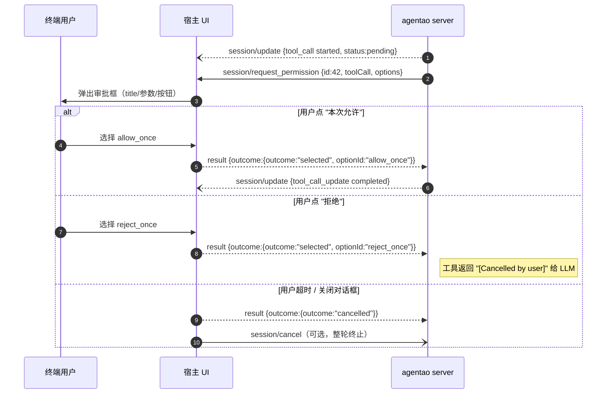
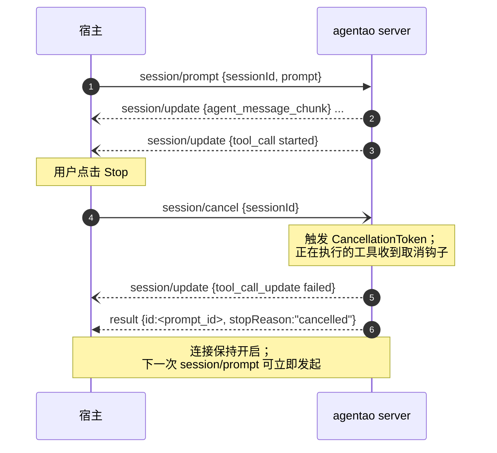

# 3.2 Agentao 作为 ACP Server

把 Agentao 当成黑盒 ACP Server 驱动——这是**任意语言**宿主（Node / Go / Rust / Kotlin / Swift / C#…）的集成路径。

## 启动命令

```bash
agentao --acp --stdio
```

- `--acp` 打开 ACP 模式
- `--stdio` 指明传输层。v1 只有 stdio，所以 `--acp` 已隐含它；单写 `agentao --acp` 也能跑，ACP Registry 客户端就是这样启动的。只写 `--stdio` 不写 `--acp` 会以退出码 `2` 结束
- `python -m agentao --acp --stdio` 效果相同，不需要 `PATH` 上有 console script
- 进程会一直运行直到 stdin 关闭或接收到 `SIGTERM`

**凭据**：ACP 线上从不传凭据。会话的 LLM 设置从哪来，见 [提供方配置与登录](#提供方配置与登录)。

**输出**：stdout 只有 JSON-RPC 消息；日志和任何零散的 `print()` 都走 stderr。

**日志**：Agentao 会把日志写入 `<session-cwd>/agentao.log`（`session/new` 里传入的 `cwd`）。宿主可以轮询/监听这个文件做调试。

### 手动冒烟测试

管道送进两条请求，读回两条响应：

```bash
OPENAI_API_KEY=sk-... OPENAI_BASE_URL=https://api.openai.com/v1 OPENAI_MODEL=gpt-5.4 \
agentao --acp --stdio <<'EOF'
{"jsonrpc":"2.0","id":1,"method":"initialize","params":{"protocolVersion":1,"clientCapabilities":{}}}
{"jsonrpc":"2.0","id":2,"method":"session/new","params":{"cwd":"/tmp","mcpServers":[]}}
EOF
```

stdout 上应看到（节选）：

```json
{"jsonrpc":"2.0","id":1,"result":{"protocolVersion":1,"agentCapabilities":{"loadSession":true,…},"authMethods":[],"agentInfo":{"name":"agentao","title":"Agentao","version":"<已安装版本>"},"_meta":{…}}}
{"jsonrpc":"2.0","id":2,"result":{"sessionId":"sess_<32 位十六进制>","configOptions":[…]}}
```

如果 `id: 2` 返回错误 `-32000`，说明没有配置提供方，见 [故障排查](#故障排查)。想交互式地再发一条 prompt，见 [3.1 · 60 秒快速尝鲜](./1-acp-tour#_60-秒快速尝鲜)。

## 提供方配置与登录

从 [ACP Registry](https://agentclientprotocol.com/registry) 安装 Agentao 的客户端会通过 `uvx` 启动它（`uvx agentao@<version> --acp`）。这时既没有 `.env` 可改，`PATH` 上也没有 `agentao`。从 0.5.9 起，`--acp` 和 `--login` 不再需要任何 `[cli]` 额外依赖。针对这种情况，Agentao 支持 ACP **Terminal Auth**。

### Terminal Auth 登录

1. **声明。** 客户端在 `initialize` 中声明 Terminal Auth（`clientCapabilities.auth.terminal: true`，或旧式 `clientCapabilities._meta["terminal-auth"]: true`）时，`authMethods` 里有一个 `terminal` 方法，`args` 为 `["--login"]`。两种写法都只认布尔 `true`。其他客户端拿到 `authMethods: []`。
2. **没有提供方就拒绝。** `initialize` 从不需要凭据。没有配置提供方时，`session/new` 和 `session/load` 返回 `-32000`（`auth_required`），消息里写明缺了哪些字段；对不支持 Terminal Auth 的客户端，还会给出一条不依赖 `PATH` 上 `agentao` 的登录命令：`uvx agentao@<version> --login`。
3. **登录。** 客户端把登录作为单独的终端进程运行：可以把 `--login` 追加到启动参数后面（ACP 规范），也可以用它替换启动参数（Registry 文档）。两种都行，且 `--login` 优先于 `--acp`。登录会询问提供方、API key（隐藏输入）、base URL、模型和线路协议（`api_format`：`ANTHROPIC` 默认 `anthropic-messages`，其余默认 `openai-completions`），以 `0600` 权限写入 `~/.agentao/llm.json`，然后以 `0` 退出。Ctrl-C 退出码 `130`，输入结束退出码 `1`，保存失败或拒绝覆盖也都以非零退出。
4. **重试。** 下一个 `session/new` 会读到新文件，不论是重连后还是在同一进程里。已经存在的会话保留它创建时的配置。

`agentao --login` 在任何终端里也能用。在 `--acp` 和 `--login` 模式下，未知参数会以退出码 `2` 拒绝。

### 会话的 LLM 设置从哪来

每次 `session/new` 和 `session/load` 都会重新解析 LLM 设置。三层，优先级从高到低：

| 层 | 来源 |
|----|------|
| 1 | server 的**启动环境**（客户端的 `env` 块） |
| 2 | 会话项目的 **`<cwd>/.env`**。只读不写，也不会到 `cwd` 上层去找 |
| 3 | **登录文件** `~/.agentao/llm.json` |

规则：

- 空值视为未设置。
- **先选定提供方。** 最高的、明确写了提供方的那一层胜出（第 1、2 层看 `LLM_PROVIDER`，文件看 `provider`），默认 `OPENAI`。有没有 API key 不参与这个选择：某个 shell 为别的工具导出了 `OPENAI_API_KEY`，不会把 DeepSeek 登录变成 OpenAI 会话。
- 字段只在该提供方的前缀下读取；登录文件只有在它的 `provider` 一致时才参与。
- **API key、base URL 和线路协议一起取。** 它们来自设置了 key 的最高那一层。某层只有 key 没有 URL，URL 就算缺失，而不会去借登录文件的 URL——这样为别的工具导出的 key 永远不会被发到你登录的那个端点。
- `session/set_config_option` 切换提供方时，按会话自己的快照解析，从不读进程环境。

::: warning 0.5.8 起的变化——项目 `.env` 只提供 LLM 设置
一个 ACP 进程服务多个项目的会话。把某个项目的 `.env` 加载进共享环境，曾让它的凭据泄漏到之后的每个会话。默认会话路径现在不往 `os.environ` 写任何东西。`.env` 以前提供的其他东西都必须来自**启动环境**：`mcp.json` 里的 MCP `${VAR}` 展开、web 工具的 key（`JINA_API_KEY`、`BOCHA_API_KEY`）、`GITHUB_TOKEN`、URL 策略白名单。自己注入 `agent_factory` / `provider_resolver` 的宿主保留旧行为。
:::

### 客户端说明

- **DeepChat** 是这套流程的验收客户端。登录、重连、`session/new` 和第一个任务已在 DeepChat v1.1.2 + Agentao 0.5.11 上实测通过（2026-10-06）。
- **Zed**（截至 `e8c6c67fad`）会跳过只有 `uvx` 分发方式的 Registry 条目。在 Zed 里请把 Agentao 配成自定义 agent server，见 [3.5 · 在 Zed 里注册 Agentao](./5-zed-ide-integration#_3-5-2-在-zed-里注册-agentao)。
- Agentao 提供基础的 ACP 互通，不使用客户端的 `fs/*` 或 `terminal/*` 方法，见 [Agentao 不使用的客户端能力](#agentao-不使用的客户端能力)。

## 启动时恢复会话

```bash
agentao --acp --resume                 # 恢复最近保存的会话
agentao --acp --resume <SESSION_ID>    # 恢复指定会话（UUID / 前缀 / 时间戳）
```

ACP 是客户端驱动的——server 不能自己开会话——所以 `--resume` 装载一个**由第一个 `session/new` 消费的一次性指令**。该请求会注入持久化历史、重新激活该会话保存时处于激活状态的技能、把历史作为 `session/update` 通知重放（和 `session/load` 完全一致），并返回**持久化的 `sessionId`** 而非新生成的。此后该连接上的每个 `session/new` 都是全新空会话。

会话存储以客户端传入的 `cwd` 为键，因此查找在请求时针对 `<cwd>/.agentao/sessions` 进行。任何可恢复的未命中——空存储、未知 id、文件损坏、或 id 已在注册表中存活——都会**降级为全新会话**（以 WARNING 记录），而不是让客户端的第一个 `session/new` 失败。返回 `auth_required` 时不会消费该指令，所以登录后的重试仍会恢复。

> 恢复出的 `sessionId` 只在 `session/new` 响应里返回，因此重放的 `session/update` 通知会**先于**客户端得知该 id 到达。对 `session/update.sessionId` 做严格校验的客户端可能会丢弃这些早到的更新。server 没有办法更早告知这个 id。从下一次 prompt 起对话仍能正确续上。

## 完整方法清单

### 宿主 → Agent（请求方法）

| 方法 | 作用 | 关键参数 |
|------|------|---------|
| `initialize` | 握手 + 能力协商 | `protocolVersion:int, clientCapabilities:obj, clientInfo?:obj` |
| `session/new` | 创建新会话 | `cwd:string, mcpServers:array`（没有就传 `[]`） |
| `session/prompt` | 发送一轮用户提示 | `sessionId:string, prompt:array<ContentBlock>` |
| `session/cancel` | 取消进行中的 prompt（通知） | `sessionId:string` |
| `session/load` | 恢复已保存的会话 | `sessionId:string, cwd:string, mcpServers:array` |
| `session/set_config_option` | 切换模型 / 提供方 | `sessionId, configId:"model", value`——[C.8](/zh/appendix/c-acp-messages#c-8-session-set-config-option) |
| `session/set_mode` | 设置权限预设 / 模式 | `sessionId, modeId`——[C.10](/zh/appendix/c-acp-messages#c-10-session-set-mode) |
| `_agentao.cn/set_model` | 自由文本换模型（扩展） | `sessionId, model`——[C.9](/zh/appendix/c-acp-messages#c-9-agentao-cn-set-model-扩展) |

`session/set_model` 和 `session/list_models` 仍作为标准化之前的兼容别名应答。请改用 `session/set_config_option`。

### Agent → 宿主（1 个请求、1 个通知、1 个扩展）

| 方法 | 性质 | 作用 |
|------|------|------|
| `session/update` | 通知 | 流式事件：文本 chunk、思考、工具调用状态 |
| `session/request_permission` | 请求（需 Client 应答） | 请求批准危险工具（写文件、跑 shell 等） |
| `_agentao.cn/ask_user` | 请求（扩展） | 向用户追问文本 |

## 握手 `initialize`

**请求**：

```json
{
  "jsonrpc": "2.0",
  "id": 1,
  "method": "initialize",
  "params": {
    "protocolVersion": 1,
    "clientCapabilities": {},
    "clientInfo": {
      "name": "my-ide",
      "version": "1.0.0"
    }
  }
}
```

**Agentao 响应**：

```json
{
  "jsonrpc": "2.0",
  "id": 1,
  "result": {
    "protocolVersion": 1,
    "agentCapabilities": {
      "loadSession": true,
      "promptCapabilities": {
        "image": true,
        "audio": false,
        "embeddedContext": false
      },
      "mcpCapabilities": {
        "http": true,
        "sse": true
      }
    },
    "authMethods": [],
    "agentInfo": {
      "name": "agentao",
      "title": "Agentao",
      "version": "0.2.14"
    },
    "_meta": {
      "_agentao.cn/extensions": [
        {
          "method": "_agentao.cn/ask_user",
          "description": "Request free-form text input from the user."
        }
      ]
    }
  }
}
```

### 规则要点

- `protocolVersion` 必须是**整数**（`"1"` 字符串、`True` 都会被拒）
- 版本协商：若你传的版本 Agentao 支持，原样回传；否则回传 Agentao 支持的最高版本。**不报错**——由 Client 决定是否继续
- `clientCapabilities` 是 `{}` 也必须传（必填，类型必须是 object）
- `agentInfo.version` 取自 `agentao.__version__`，显示的是已安装的版本，而不是上面这个字面值
- 除非客户端声明了 Terminal Auth，`authMethods` 都是 `[]`——见 [Terminal Auth 登录](#terminal-auth-登录)

## 创建会话 `session/new`

```json
{
  "jsonrpc": "2.0",
  "id": 2,
  "method": "session/new",
  "params": {
    "cwd": "/path/to/user/project",
    "mcpServers": [
      {
        "name": "github",
        "command": "npx",
        "args": ["-y", "@modelcontextprotocol/server-github"],
        "env": [{"name":"GITHUB_TOKEN","value":"<secret>"}]
      }
    ]
  }
}
```

**响应**：

```json
{"jsonrpc":"2.0","id":2,"result":{"sessionId":"sess_3a8f1b2c…","configOptions":[…]}}
```

### 关键说明

- `cwd` 决定了这个会话的**工作目录**——文件工具、`AGENTAO.md`、`.agentao/`（记忆、权限、`mcp.json`、会话）全部相对它。必须是已存在目录的绝对路径。多会话并发时务必不同
- `mcpServers` 必填，没有就传 `[]`
- `configOptions` 列出 `session/set_config_option` 可选的模型（[C.8](/zh/appendix/c-acp-messages#c-8-session-set-config-option)）

### 客户端注入的 MCP 服务器

`mcpServers` 的条目会被转换成 [`extra_mcp_servers` 参数](/zh/part-2/2-constructor-reference#第-2-档-·-生产常用)：

| 条目 | `mcpCapabilities` | 说明 |
|------|-------------------|------|
| stdio `{name, command, args, env}`（不写 `type`） | 始终支持 | `env` 是 `{name, value}` 列表 |
| `{type:"http", name, url, headers}` | `http: true` | Streamable HTTP；`headers` 是 `{name, value}` 列表 |
| `{type:"sse", name, url, headers}` | `sse: true` | 旧式 SSE |

- 不写 `type` 的条目就是 **stdio**，需要 `command`。和 `mcp.json` 不同，这里裸 `url` 不代表 HTTP。其他 `type` 一律以 `-32602` 拒绝
- 客户端注入的每个服务器都带 `trust: false`，其工具仍要走确认；也都带 `oauth: false`：Agentao 绝不为它发起浏览器登录
- 客户端注入的服务器会**替换**项目 `.agentao/mcp.json` 中同名的条目
- 这些服务器**只属于本会话**。兄弟会话看不到它们，会话关闭时断开

### Agentao 不使用的客户端能力

这些是 v1 的非目标。Agentao 会明确拒绝或根本不去调用，绝不悄悄降级。

| 功能 | 状态 |
|------|------|
| `fs/read_text_file` / `fs/write_text_file` | 不使用。Agentao 在会话 `cwd` 下**本地**读写文件。客户端的 `fs` 标志会被记录但不参考，所以编辑器里未保存的缓冲区看不到 |
| `terminal/*` | 不使用。shell 命令通过 `run_shell_command` 在本地运行，工具输出以文本内容送达，从不是 `terminal` 条目 |
| MCP-over-ACP | 不支持。请在 `session/new.mcpServers` 里传服务器 |
| `session/prompt` 的 `audio` 和内嵌 `resource` 块 | 以 `-32602` 拒绝，能力标志也这样声明 |

## 会话与并发

| 行为 | 结果 |
|------|------|
| 一个 server 上开多个会话 | 支持。各自有独立的 `cwd`、历史、权限引擎和 MCP 服务器 |
| **不同**会话上的并发 prompt | 支持。handler 跑在工作线程池上 |
| **同一**会话上一轮未完又来一个 `session/prompt` | `-32600`「session … already has an active turn」。不会排队：等第一个响应回来 |
| 对本连接上仍存活的 id 做 `session/load` | `-32600`。没有关闭会话的方法，所以该 id 会一直存活到连接结束。继续用这个活会话，或者在新的 server 进程里加载它 |
| `allow_always` / `reject_always` 应答 | 按会话、按工具名保存。不与兄弟会话共享，会话结束即失效 |
| 该会话一轮进行中时切换模型或模式 | `-32600`，等这一轮结束再试 |

## 发送提示 `session/prompt`

```json
{
  "jsonrpc": "2.0",
  "id": 3,
  "method": "session/prompt",
  "params": {
    "sessionId": "sess-a1b2c3",
    "prompt": [
      {"type": "text", "text": "找到 3 个最大的 .py 文件"}
    ]
  }
}
```

v1 `prompt` 数组里可以放 `text`、`resource_link`（作为引用写进提示词）和 `image`（`{"type":"image", "data": "<base64>", "mimeType": ...}`）。其他类型的块会以 `-32602` 拒绝。字段规则和图片限制见 [C.3](/zh/appendix/c-acp-messages#c-3-session-prompt)。

**响应**（一次 prompt 的最终**结果**）会在所有流式更新结束后返回：

```json
{
  "jsonrpc":"2.0",
  "id":3,
  "result":{
    "stopReason":"end_turn"
  }
}
```

### 停止原因

ACP v1 的 `stopReason` 是封闭的五元枚举，既没有 `error` 成员，也没有「等」：

| `stopReason` | 何时出现 |
|--------------|----------|
| `end_turn` | 正常结束。模型没写出正文（`no_output`、`reasoning_only`）的轮次，以及被插件钩子以 `continue: false` 结束的轮次，也算这一类 |
| `cancelled` | 会话的取消令牌被触发（`session/cancel`、连接关闭或会话拆除）。优先于其他所有原因 |
| `max_turn_requests` | 工具迭代预算耗尽，或死循环（重复相同调用）被叫停 |
| `max_tokens` | 模型回复在 token 上限处被截断 |
| `refusal` | schema 接受但从不发出——Agentao 没有内容拒答检测 |

优先级：先 `cancelled`，再迭代预算，最后看轮次的未完成原因。将来出现的未知原因映射为 `end_turn`。

### 模型调用失败返回错误

从 0.5.4 起，模型调用在重试后仍失败（提供方 5xx、限流或鉴权失败）的那一轮返回 JSON-RPC **错误**，而不是 result：

```json
{"jsonrpc":"2.0","id":3,"error":{"code":-32603,"message":"[LLM API error: 502 Bad Gateway]","data":{"reason":"llm_error"}}}
```

- `message` 与客户端已在流上收到的提示一字不差。
- 请按 `data.reason == "llm_error"` 判断，不要匹配文字。
- 原因：没有哪个 `stopReason` 成员表示「模型调用失败」，而 `end_turn` 会让客户端以为这一轮成功了。0.5.4 之前对这种轮次读到 `end_turn` 的客户端，需要处理这个错误。
- 取消仍然优先：被取消中断的提供方调用报告为 `cancelled`。
- 无论哪种情况都会释放轮次锁，会话可以接着处理下一个 prompt。

## 流式更新 `session/update`（通知）

在 `session/prompt` 返回前，Agentao 会发出**多条**：

```json
{
  "jsonrpc":"2.0",
  "method":"session/update",
  "params":{
    "sessionId":"sess-a1b2c3",
    "update":{
      "sessionUpdate":"agent_message_chunk",
      "content":{"type":"text","text":"我来帮你"}
    }
  }
}
```

`sessionUpdate` 字段的关键值：

| 值 | 含义 |
|----|------|
| `agent_message_chunk` | 流式文本 chunk（错误也走这里，以 `Error: ` 开头） |
| `agent_thought_chunk` | 思考过程，以及子 agent 的开始 / 结束标记 |
| `tool_call` | 工具开始调用 |
| `tool_call_update` | 工具执行进度/输出/结果 |
| `plan` | `todo_write` 的任务清单 |

宿主不应对通知响应（JSON-RPC 2.0 规范：通知无 `id`）。完整的事件映射、文件编辑 diff 和输出上限见 [C.4](/zh/appendix/c-acp-messages#c-4-session-update-⇠-通知)。

## 工具确认 `session/request_permission`（请求）

当 Agentao 尝试调用一个 `requires_confirmation=True` 的工具时：

```json
{
  "jsonrpc":"2.0",
  "id":42,
  "method":"session/request_permission",
  "params":{
    "sessionId":"sess-a1b2c3",
    "toolCall":{
      "toolCallId":"call-x",
      "status":"pending",
      "title":"Run: rm -rf build/",
      ...
    },
    "options":[
      {"optionId":"allow_once","name":"Allow once","kind":"allow_once"},
      {"optionId":"allow_always","name":"Always allow","kind":"allow_always"},
      {"optionId":"reject_once","name":"Reject once","kind":"reject_once"},
      {"optionId":"reject_always","name":"Always reject","kind":"reject_always"}
    ]
  }
}
```

**宿主必须响应。** server 的等待没有超时，所以这一轮会一直阻塞，直到应答到达或连接关闭：

```json
{
  "jsonrpc":"2.0",
  "id":42,
  "result":{
    "outcome":{"outcome":"selected","optionId":"allow_once"}
  }
}
```

建议的宿主 UI 流程：
1. 收到请求 → 弹出模态框展示 `title` 和 `toolCall` 细节
2. 用户选择 → 立即 `result` 响应
3. 若用户超时不响应，宿主主动响应 `{"outcome":"cancelled"}` 并可选 `session/cancel`



`allow_always` / `reject_always` 只在该会话内、按工具名记住，之后的调用不再往返。MCP Skills 闸门发起的确认是例外：它只给两个 `*_once` 选项，并忽略已保存的 `allow_always`（见 [host-api.md](https://github.com/jin-bo/agentao/blob/main/docs/reference/host-api.md#answering-a-confirmation-the-mcp-skills-gate-asks-gate_note)）。

### 会被视为拒绝的失败

确认路径上的每种失败都按「工具被拒绝」处理，不会让这一轮崩掉：

- server 等待时连接关闭
- 客户端以 JSON-RPC 错误应答（以 error 级别记录）
- result 不是对象，或 `outcome` / `optionId` 无法识别
- `{"outcome":"cancelled"}`

## 取消 `session/cancel`

```json
{"jsonrpc":"2.0","method":"session/cancel","params":{"sessionId":"sess-a1b2c3"}}
```

效果：当前 `session/prompt` 的轮次会以 `stopReason:"cancelled"` 结束。取消令牌会传到模型调用、工具执行和子 agent。ACP 把 `session/cancel` 定义为通知；客户端若带 `id` 发送，会收到 `"result": null`。



::: warning 挂起的权限请求要自己应答
取消不会替你应答仍未关闭的 `session/request_permission`，worker 会一直阻塞到客户端回复。发出 `session/cancel` 之后，请按 ACP 规范对每个挂起的请求回复 `{"outcome":"cancelled"}`。
:::

### 取消无效果的情况

该 handler 是幂等的。以下情况静默成功：

| 情形 | 行为 |
|------|------|
| 没有正在进行的轮次 | 无操作 |
| 这一轮已经取消过 | 无操作 |
| 会话已关闭 | 无操作 |
| 未知 `sessionId` | 以请求发送时返回 `-32600`；以通知发送时直接丢弃 |

## 恢复会话 `session/load`

用于**持久化会话**场景：保存好 `sessionId`，进程重启后恢复。Agentao 在 `initialize` 响应里声明 `loadSession:true` 表示支持。客户端不用发送历史：Agentao 把每个会话存在 `<cwd>/.agentao/sessions/` 下，从那里读回，并在应答前以 `session/update` 通知回放历史。参数是 `sessionId`、`cwd` 和 `mcpServers`（没有就传 `[]`）。加载一个仍在活动的 id 会以 `-32600` 拒绝；未知 id 或无法读取的会话文件也一样。

```json
{
  "jsonrpc":"2.0",
  "id":5,
  "method":"session/load",
  "params":{
    "sessionId":"sess-restored",
    "cwd":"/path/to/project",
    "mcpServers":[]
  }
}
```

加载会恢复历史和激活的技能，不恢复模型、计划模式或工具状态。每条持久化消息如何回放，见 [C.7](/zh/appendix/c-acp-messages#c-7-session-load)。

## ⚠️ 常见陷阱

::: warning ACP 协议层最容易踩的坑
1. **帧格式**：一定是 NDJSON，JSON 里**不能有裸换行**——写 JSON 库时注意 compact 模式
2. **stdout 污染**：Agentao 保证所有日志走 `agentao.log` + stderr，**不污染 stdout**。你的 Client 读 stdout 一定拿到纯 JSON
3. **stdin 阻塞**：如果 Client 在发送请求后不读 stdout，Server 的 stdout buffer 会撑爆。用异步 I/O 或专门读取线程
4. **版本字段类型**：`protocolVersion` 必须 int，不是日期字符串
5. **`session/update` 不回应**：JSON-RPC 2.0 禁止为通知发响应
:::

## 故障排查

| 现象 | 可能原因 | 处理 |
|------|----------|------|
| `initialize` 一直没有响应 | 客户端把 JSON 美化成了多行 | 每行发一个紧凑的 JSON 对象，换行即消息结束 |
| `session/new` 返回 `-32002` | 没发 `initialize`，或它失败了 | 先发 `initialize`，并检查其响应里有没有 `error` |
| `session/new` / `session/load` 返回 `-32000`（`auth_required`） | [三层来源](#会话的-llm-设置从哪来)里都没有 API key、base URL 或模型 | 运行客户端的 Terminal Auth 登录，或在终端里运行 `uvx agentao@<version> --login`，然后重连。消息里写明了缺哪些字段 |
| `session/new` 返回 `-32603`「LLM configuration error」 | `~/.agentao/llm.json` 或项目 `.env` 存在但不可用（JSON 错误、字段不是字符串、`LLM_TEMPERATURE` 不是数字） | 修好或删掉提示的文件。重新登录会重写 `llm.json` |
| 项目 `.env` 里的工具 key、MCP `${VAR}` 或 `GITHUB_TOKEN` 不生效 | 从 0.5.8 起，项目 `.env` 只提供 LLM 设置 | 把变量放进客户端启动配置的 `env` 块 |
| `session/new` 因 `cwd` 返回 `-32602` | `cwd` 不是绝对路径、不存在或是文件 | 传一个已存在目录的绝对路径 |
| `session/new` 因 `mcpServers` 返回 `-32602` | 缺了这个字段，或某个条目有 `url` 却没写 `type` | 传 `[]`；URL 条目写明 `"type":"http"` 或 `"type":"sse"` |
| `session/prompt` 返回 `-32600`「already has an active turn」 | 第一轮还没结束又来了一个 prompt | 等第一个响应回来，或换一个会话 |
| 带 `image` 块的 `session/prompt` 返回 `-32602` | 用了引用式 `uri`、未定义的键、非 `image/*` 的 `mimeType`、base64 有误或过大、字节不是 PNG / JPEG / GIF / WEBP，或图片太多 | 在上限内发送内联 `{data, mimeType}`；其他格式先转成 PNG 或 JPEG |
| 带 `audio` 或内嵌 `resource` 的 `session/prompt` 返回 `-32602` | v1 不支持 | 只发 `text`、`resource_link` 和内联 `image` |
| 这一轮卡在某个工具调用上 | 客户端没有应答 `session/request_permission` | 把收到的请求（id 形如 `srv_…`）作为 JSON-RPC 响应回传 |
| 自己嵌入时 stdout 上出现杂讯 | 构造 `AcpServer` 时显式传了流，stdout 守卫没有启用 | 生产环境用 `agentao --acp --stdio` 启动 |

更多 IDE 侧的现象见 [3.5 · IDE 集成排错](./5-zed-ide-integration#_3-5-8-ide-集成排错)。

## 端到端最小宿主（Python 实现，仅作演示）

::: tip ⚡ 端到端可跑（约 5 分钟）
**产出** —— 从 50 行 Python 客户端驱动 `agentao --acp --stdio`；能看到 `session/update` 流式通知 + 最终 `stopReason`。
**技术栈** —— `pip install 'agentao[cli]>=0.5.0'` + 3 个环境变量；下方 Python 即所需的全部宿主代码。
**运行** —— 粘贴到 `acp_demo.py`，然后 `python acp_demo.py`。
**宿主不是 Python？** —— 读懂线协议流后，照 [3.3 宿主作为 ACP Client](./3-host-client-architecture) 翻译到目标语言。
:::

即便你的宿主不是 Python，这个例子也帮助理解协议流：

```python
"""最小 ACP 客户端（Python），驱动 agentao --acp --stdio。"""
import json, subprocess, threading, queue, uuid

class AcpClient:
    def __init__(self):
        self.proc = subprocess.Popen(
            ["agentao", "--acp", "--stdio"],
            stdin=subprocess.PIPE, stdout=subprocess.PIPE,
            bufsize=0, text=True,
        )
        self._pending: dict = {}
        self._notifications: queue.Queue = queue.Queue()
        threading.Thread(target=self._reader, daemon=True).start()

    def _reader(self):
        for line in self.proc.stdout:
            msg = json.loads(line)
            if "id" in msg and "method" not in msg:        # 是响应
                fut = self._pending.pop(msg["id"], None)
                if fut: fut.put(msg)
            elif "method" in msg and "id" not in msg:       # 是通知
                self._notifications.put(msg)
            elif "method" in msg and "id" in msg:           # 是请求（Agent→Client）
                self._notifications.put(msg)

    def call(self, method, params):
        id_ = str(uuid.uuid4())
        fut: queue.Queue = queue.Queue(maxsize=1)
        self._pending[id_] = fut
        msg = {"jsonrpc":"2.0","id":id_,"method":method,"params":params}
        self.proc.stdin.write(json.dumps(msg) + "\n"); self.proc.stdin.flush()
        return fut.get()

    def respond(self, id_, result):
        msg = {"jsonrpc":"2.0","id":id_,"result":result}
        self.proc.stdin.write(json.dumps(msg) + "\n"); self.proc.stdin.flush()

# 使用
cli = AcpClient()
print(cli.call("initialize", {"protocolVersion":1,"clientCapabilities":{}}))
r = cli.call("session/new", {"cwd":"/tmp", "mcpServers":[]})
sid = r["result"]["sessionId"]
# 异步监听通知队列，同时发 prompt
cli.call("session/prompt", {
    "sessionId": sid,
    "prompt":[{"type":"text","text":"列 3 个最大文件"}],
})
```

生产级 Client 代码范式（错误处理、UI 桥接、超时）见 [3.3 宿主作为 ACP 客户端架构](./3-host-client-architecture)。

## 关键源码位置

| 话题 | 文件 |
|------|------|
| 启动入口 | [`agentao/cli/_light.py`](https://github.com/jin-bo/agentao/blob/main/agentao/cli/_light.py)（`run_acp_mode`）、[`agentao/acp/__main__.py`](https://github.com/jin-bo/agentao/blob/main/agentao/acp/__main__.py) |
| 协议常量 | [`agentao/acp/protocol.py`](https://github.com/jin-bo/agentao/blob/main/agentao/acp/protocol.py) |
| 握手 + 能力宣告 | [`agentao/acp/initialize.py`](https://github.com/jin-bo/agentao/blob/main/agentao/acp/initialize.py)（`AGENT_CAPABILITIES`） |
| Terminal Auth + LLM 解析 | [`agentao/acp/llm_auth.py`](https://github.com/jin-bo/agentao/blob/main/agentao/acp/llm_auth.py)、[`agentao/embedding/llm_config.py`](https://github.com/jin-bo/agentao/blob/main/agentao/embedding/llm_config.py) |
| 会话创建 + MCP 转换 | [`agentao/acp/session_new.py`](https://github.com/jin-bo/agentao/blob/main/agentao/acp/session_new.py)、[`agentao/acp/mcp_translate.py`](https://github.com/jin-bo/agentao/blob/main/agentao/acp/mcp_translate.py) |
| Prompt 处理 + 停止原因 | [`agentao/acp/session_prompt.py`](https://github.com/jin-bo/agentao/blob/main/agentao/acp/session_prompt.py) |
| 事件映射 + 权限 | [`agentao/acp/transport.py`](https://github.com/jin-bo/agentao/blob/main/agentao/acp/transport.py)、[`agentao/acp/_transport_interaction.py`](https://github.com/jin-bo/agentao/blob/main/agentao/acp/_transport_interaction.py) |

server 内部怎么搭的（分发器、stdout 守卫、关闭顺序、测试）：[ACP server 内部结构](https://github.com/jin-bo/agentao/blob/main/docs/design/acp-server-internals.zh.md)。

→ [第 4 部分 · 事件层与 UI 集成](/zh/part-4/)
